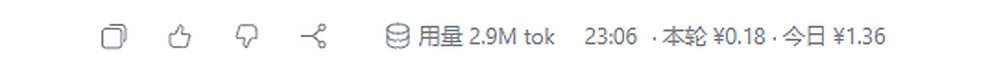

# turn-cost-footer（本轮花费）

在每条助手回复的页脚末尾、时间之后，追加**本轮真实消耗**与**今日累计**（人民币）：

```
用量 3.7M tok 20:26 · 本轮 ¥0.12 · 今日 ¥3.41
```

字号跟随页脚时间，与「20:26」等大，不额外抢眼。



独立插件：不读取、不修改、也不依赖 `dsh-whale-widget`；成本表、存储、路由都是自己的，
所以鲸鱼插件被禁用、升级甚至卸载都不会影响它。

## 安装

已经随本机 profile 装好（`link:` 指向本目录）。换一台机器时二选一：

```sh
# 从 GitHub 直接装（仓库推送之后）
dsh plugin --profile web add github:qcy-good/turn-cost-footer
```

或把本目录放进 profile 的 `node_modules` 后用插件管理器安装（`plugin_manager install_bundle`）。
上架市场的步骤见 [PUBLISHING.md](PUBLISHING.md)。

## 成本是怎么算出来的（用了哪些接口）

**结论先说：不访问任何计费接口或余额接口，也不联网。** 金额完全由本机会话日志里的
真实 token 用量折算而来。

1. **数据源：Host 事件 `session/event`**
   Host 半边订阅 DSH 的会话日志追加事件 `session/event`（签名 `(session, event)`），
   只处理两种事件：
   - `assistant/message`：每次模型调用产生的助手消息，其 `data.usage` 就是服务商响应里
     原样记录的 `TokenUsage`；
   - `turn/end`：一轮结束，做结算。
2. **用量字段（token 都是真实计数，不是按字数估的）**

   | 字段 | 含义 | 计价方式 |
   | --- | --- | --- |
   | `usage.inputTokens` | 未命中缓存的输入 token | × `cacheMiss` |
   | `usage.cacheReadTokens` | 命中缓存的输入 token | × `cacheHit` |
   | `usage.outputTokens` | 输出 token（推理 token 已包含在内，不再重复加） | × `output` |

   模型名取自 `data.message.source.model`，用于在价格表里选档。
3. **折算**：金额 = Σ(各字段 token / 1,000,000 × 对应单价)，单价为「元 / 百万 token」。
   峰时（北京时间工作日 9–12、14–18）单价 × `peakMultiplier`，其余为谷时价。
4. **对外只有一个接口**，而且是本插件自己注册的只读路由，供 Client 半边轮询：
   `GET /turn-cost-footer/turn.json`。没有调用 DeepSeek 的余额 / 账单接口，没有读
   `credentials`，也没有走 `llm` 服务。

实测样例（真实一轮）：`turn 50`，3,025,392 tok，`deepseek-flash` → ¥0.0840。

## 工作原理

**Host 半边**（`index.js`）只依赖会话日志：

- 每收到 `assistant/message`，按上表把该 step 的用量折算成金额并累加到本 Turn；
- 收到 `turn/end` 时结算，`seq` 自增，并把最近一轮写入
  `$DSH_HOME/.turn-cost-footer.json`（默认 `~/.dsh/.turn-cost-footer.json`），
  所以刷新页面或重启应用后仍能回填最近一轮；
- 子代理会话的轮次只计入「今日消耗」，不会顶掉你正在看的会话页脚；
- 只暴露一条只读路由：

```json
GET /turn-cost-footer/turn.json
{
  "ok": true, "seq": 3, "enabled": true, "showToday": true, "currency": "CNY",
  "turn": 50, "amount": 0.084, "tokens": 3025392, "model": "deepseek-flash",
  "ts": 1793974422671, "todayUsage": 0.1589
}
```

还没有任何一轮真实用量时 `amount` 为 `null`，Client 半边据此不显示角标（绝不编造金额）。

**Client 半边**（`client.js`）每秒轮询一次上面的路由：

- 只有 `seq` 变化时才写 DOM；把 `span.turn-cost-footer-cost` 插到最后一条完成回复的页脚
  （`[data-clock="end"]` 行里的 `[class*="endInfo"]`，紧跟时间之前）；
- 用户消息没有这行页脚，所以永远不会被注入；
- React 重渲染会重建页脚，靠 `MutationObserver` 加 300 / 1200 / 3000 ms 重试阶梯补插；
- 所有选择器集中在 `SELECTORS` 一个对象里，DOM 结构变了只改这一处；
- Host 掉线（插件被停用/卸载）两秒后自动撤掉旧角标。

## 配置

改已安装 patch 行的 `config:` 段（profile 的 `cordis.patch.yml`），或安装前改本包的
`cordis.patch.yml`；改完重启 DSH，或停用/启用该插件行即可生效。

| 键 | 默认值 | 含义 |
| --- | --- | --- |
| `enabled` | `true` | 总开关；`false` 时移除全部角标并停止插入 |
| `showToday` | `true` | 行尾是否附带今日累计金额 |
| `currency` | `CNY` | 显示单位 |
| `peakHours` | `[[9,12],[14,18]]` | 北京时间峰时区间 |
| `peakMultiplier` | `2` | 峰时单价 = 谷时单价 × 该倍率 |
| `weekendValley` | `true` | 周末一律按谷时价 |
| `prices` | 见 patch | 「元 / 百万 token」：`cacheHit`、`cacheMiss`、`output` |
| `debug` | `false` | 每轮结算时在 Host 控制台打印明细 |

`prices` 的键按「模型 id 的最长匹配子串」命中（如 `deepseek-v4-pro`、`deepseek-flash`），
`default` 兜底，因此换了模型也不会算出离谱的金额。

## 已知限制

- 刷新页面后只回填**最近一轮**；更早的历史页脚不再补金额（线上协议只带一轮）。
- 价格表是本地配置，不是账单接口；官方调价时请同步改 `prices`。
- 会话没有提供「每条消息」的官方页脚插槽，故采用 DOM 注入；这是选择器集中管理的唯一原因。

## 卸载

在插件管理器里停用该行，或直接移除本包。它不会改动应用里的任何其他文件。
